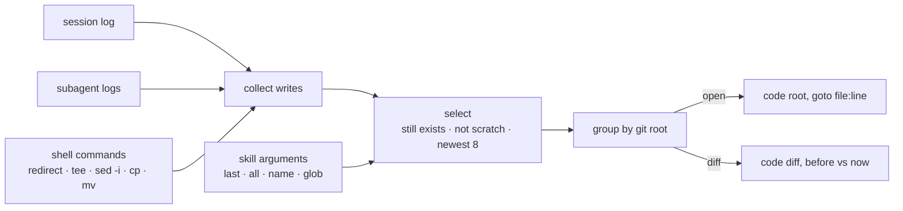

> **Moved.** `/vscode` now lives in [jhammant/claude-skills](https://github.com/jhammant/claude-skills/tree/main/plugins/desk),
> in the `desk` plugin with `/finder` and `/open`. Install it with
> `/plugin marketplace add jhammant/claude-skills` then `/plugin install desk@claude-skills`.
> This repo is archived; the README below is kept for reference.

# vscode

Open the files Claude Code just changed in VS Code, with one command.


Claude Code edits five files and says "done". Which five? To look at them yourself, you scroll
back through the conversation, copy each path, run `code` on it, then search for the part that
changed. When a subagent did some of the work, or Claude wrote a file from the shell, you won't
even see those files listed.

`/vscode` opens them for you: every file this session created or edited, in the VS Code window
for its project, at the line that last changed.

```text
> /vscode
Opened 5 files in VS Code:
  test/test_vscode.py:1  [bash, created]
  .gitignore  [bash]
  README.md:1  [created]
  skill/SKILL.md:1  [created]
  skill/scripts/vscode.py:177  [created, edited]
```

`/vscode diff` opens each one side by side with how it looked before this session touched it:

```text
> /vscode diff .gitignore
Opened 1 file in VS Code:
  .gitignore:5  [bash, edited]  (diff)
```

## Usage

| You type | It opens |
|---|---|
| `/vscode` | Files created or edited this session (the newest 8), in their project's window |
| `/vscode last` / `last 3` | The most recently edited file, or the last 3 |
| `/vscode all` | Everything touched, including scratch and `/tmp` files, with no cap |
| `/vscode diff` | Side-by-side diffs of what this session changed |
| `/vscode folder` | The project folder only |
| `/vscode README` / `src/app.ts:40` / `'*.test.ts'` | Matching session files, falling back to a repo search |
| `/vscode the migration tests` | Claude picks the files you mean from the session's file list |
| `… here` / `… new` | Your current window, or a new window |
| `/vscode read last` | Also count files Claude only read |

Keywords combine: `/vscode diff last 2`, `/vscode here README`.

## How it works

Claude Code logs every session to `~/.claude/projects/<project>/<session>.jsonl` and each
subagent to `<session>/subagents/*.jsonl`. Each successful `Write` or `Edit` entry includes the
file path, a structured patch and the file's content before the change, which is everything
this skill needs.



- **Which files:** successful `Write`, `Edit` and `NotebookEdit` results, from Claude and from
  its subagents. Shell writes (`> file`, `tee`, `sed -i`, `cp`/`mv`, `touch`) are parsed on a
  best-effort basis: `cd` is tracked and heredoc bodies are ignored, so the `>` in
  `if a > b` isn't taken for a redirect.
- **What's hidden:** temp and scratchpad files and Claude's own memory files, unless you name
  them or say `all`. Files that no longer exist are dropped. If nothing was edited this
  session, it opens your uncommitted git changes instead.
- **Which window:** files are grouped by git repo and opened with
  `code <root> --goto file:line`. VS Code switches to the window that already has that
  project open, or opens a new one. The newest file is passed first because VS Code makes the
  first file the active tab.
- **Which line:** the first changed line of the most recent edit, read from its patch.
- **Diff:** the left side is the file as it was before this session first edited it, taken
  from the log, or `git HEAD` for files changed only by shell commands. That copy goes in
  `<repo>/.git/claude-vscode/`: inside the trusted workspace, so VS Code doesn't ask about
  untrusted files, and invisible to git.

`/vscode` is a skill, so Claude reads your arguments first. Keywords and paths go straight to
the script. For a plain-English request, Claude lists the session's files and chooses the ones
you mean, using what it knows from the conversation.

## Install

```bash
git clone https://github.com/jhammant/vscode-skill.git
ln -s "$PWD/vscode-skill/skill" ~/.claude/skills/vscode
```

Claude Code picks it up in your next session. It needs Python 3.9+ (macOS's built-in
`/usr/bin/python3` works) and no other packages.

It also needs VS Code's `code` command. The script looks for it on `PATH`, then inside
`/Applications/Visual Studio Code.app`, then in `$VSCODE_BIN`. If none of those finds it, run
**Shell Command: Install 'code' command in PATH** from VS Code's Command Palette.

The script also works without Claude:

```bash
python3 skill/scripts/vscode.py --list           # what would open, and why
python3 skill/scripts/vscode.py diff --dry-run   # the exact code commands
```

## Limits

- **Files written by programs Claude runs aren't detected.** That includes Python scripts,
  code generators and `npm install`. Claude can still open those files by name.
- **Shell parsing is best effort.** It catches the common ways to write a file, not every
  possible shell command.
- **Line numbers can drift.** They come from the last `Edit`, so a later shell edit can move
  the code.
- **VS Code may ask about untrusted files.** Opening a file from outside a project, such as a
  `/tmp` file, triggers VS Code's untrusted-files prompt. That prompt is a VS Code safety
  feature, and the choice stays yours.
- **The session log format isn't a public API.** A future Claude Code release could change it.
- **Only tested on macOS with VS Code.** The script also checks the usual Linux install paths,
  and `VSCODE_BIN` can point at a fork with the same CLI, but neither is tested.

## Tests

```bash
python3 -m unittest discover -s test
```

24 tests run against fake session logs, a real git repo and a stand-in `code` binary that
records its arguments. They cover log parsing, the tricky shell cases (heredocs, `2>&1`,
`cd &&`), window grouping, diff "before" copies and every exit code. The window-targeting and
active-tab behaviour was checked by hand in VS Code.

## License

MIT
